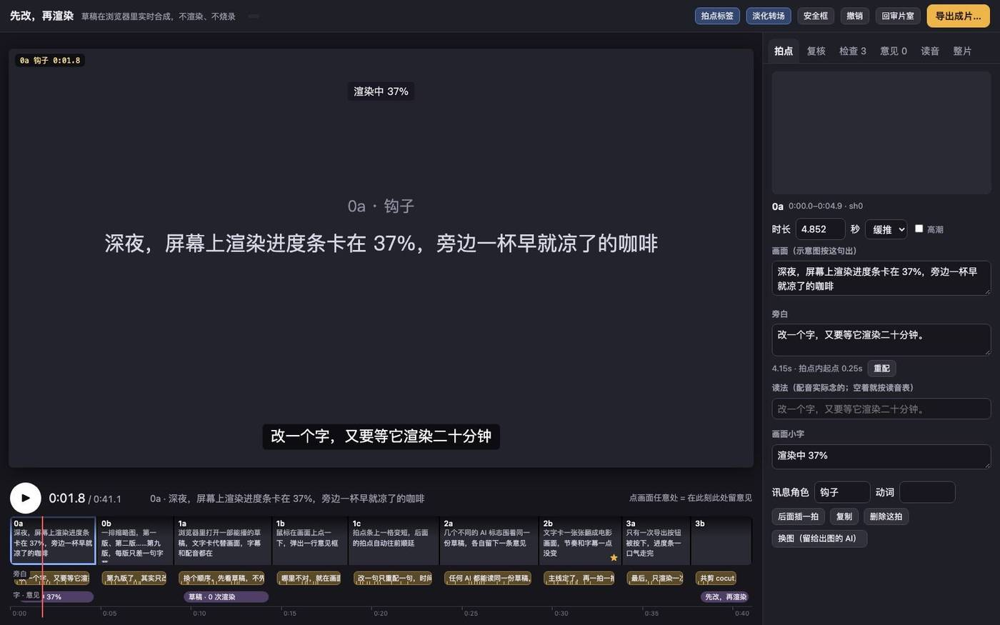
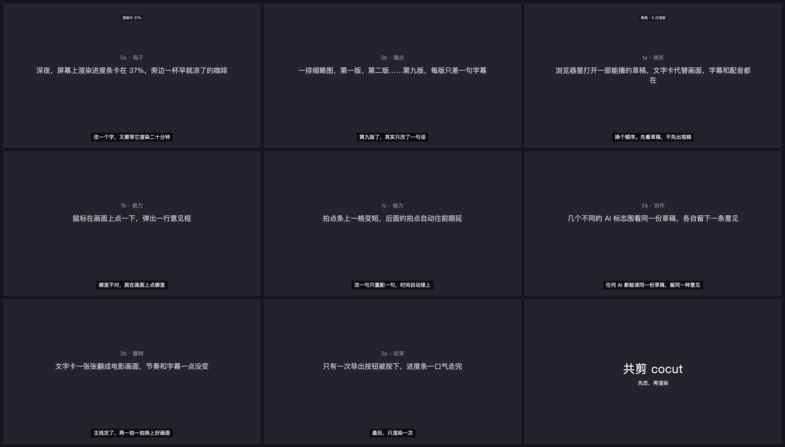
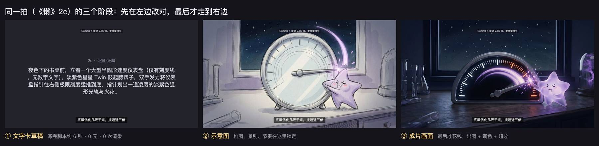

# cocut · 共剪

**先改，再渲染。** 写一份文字脚本，几秒钟就得到一部能播、能拖、能改的预览草稿：配音、字幕、节奏都在，画面先用文字卡占位。主线在草稿里改对了，最后才出图、才渲染，只渲染一次。

做视频最贵的不是生成，是「改一个字、等一次渲染」。云电脑上尤其慢。cocut 把这件事倒过来：改动都发生在浏览器里实时合成的草稿上，0 次渲染；贵的算力只花在定稿上。

## 效果


一份 40 行的文字脚本，约 6 秒就是这样一部能播的草稿：每拍有配音、字幕、镜头运动，画面先用文字卡占位。下面是它 9 拍的成品帧：



## 反差：先渲染再改 vs 先改再渲染


| 想做的事 | 先渲染再改 | cocut 草稿 |
|---|---|---|
| 看到第一个完整版本 | 先出全部画面再渲染：《懒》16 拍出图约 5.5 分钟 + 渲染（本机 1080p 约 23 秒，云电脑更久） | 约 6 秒，0 元（文字卡 + 免费配音） |
| 改一句旁白 | 重配 + 整片重新渲染 | 约 3 秒，只重配这一句，后面自动顺延 |
| 改一个多音字 / 英文名读法 | 同上 | 读音表加一条，过期的那句一键重配，字幕不变 |
| 调顺序、调时长 | 重新剪、重新渲染 | 拖拍点条，实时生效 |
| 换一拍画面 | 重新渲染 | 只换这一张图 |
| 改了九轮 | 九次渲染 | 0 次；定稿后渲染 1 次 |

左边那一格就是草稿阶段：主线、景别、节奏在这里定下来（《懒》复盘里约占叙事效果的 85% 以上），贵的出图和渲染只做一次。实测数字见 [docs/METHOD.md](docs/METHOD.md)。

## 三步试用（约 1 分钟）
```
git clone https://github.com/changsheng0804-blip/cocut.git && cd cocut
pip install edge-tts                                   # 免费配音（可选；不装就是无声草稿，按字数估时长）
python3 cocut/cli.py new examples/hello/script.md my-film
python3 server.py my-film 8790                         # 打开 http://localhost:8790/
```
只需要 Python 3.9+。实测：9 拍 41 秒的示例，从脚本到能播的草稿 **6–8 秒**（9 句配音并发生成）。

## 写你自己的脚本
照着 [examples/hello/script.md](examples/hello/script.md) 写：
```
# 片名
一句话：这部片子只想让人记住的一件事
时长：40

## 0a 钩子 push                  拍点号 + 作用，可加镜头 static/push/pull/pan/orbit、「高潮」、「片名」
画面：这一拍画面上是什么         先写清楚，以后出图就照这句
旁白：这一拍念的话
小字：画面上方的小字              可省
```
`时长：`（单拍秒数）、`图：img/0a.jpg`（已有图就直接用）、`读法：`（配音的念法）、顶部的 `配乐：music.mp3`、`读音：cocut→扣卡特`（全片读音表）都可省。

## 在草稿上改
- **看**：页面就是片子。空格播放，拖时间轴，`拍点标签` 显示拍点号。
- **改**：右侧「拍点」面板改旁白、小字、时长、镜头；改了旁白点「重配」，只重配这一句，后面的时间自动顺延。拍点条可以拖着排顺序、拉长短。
- **点哪改哪**：在画面上点一下留意见，意见会落到点中的那份素材（这拍的图、字幕或小字），以后一点就跳回去改。
- **检查**：「检查」面板实时提示旁白塞不进、总长超了、旁白太满、配音过期等，多数带一键修。
- **读音**：多音字、英文名念错了，在「读音」面板加一条（如 `cocut → 扣卡特`），字幕不变，过期的配音一键重配。
- **撤销**：每次保存自动备份到片子目录的 `history/`。

命令行也能做同样的事（给 AI 或脚本用）：`python3 cocut/cli.py --film my-film show | set 1a dur 4 | lex add ... | voice stale | note ...`，见 `cocut/cli.py` 开头的说明。

## 主线定了，再换画面
文字卡一拍一拍换成图：把图放进片子目录，在拍点面板或 `cli.py set 0a image img/0a.jpg` 指过去即可，时间、字幕、配音都不动。用什么出图（扩散模型、实拍、手绘）都行；`画面` 那句就是给出图的人或模型的说明。《懒》示例的提质流程和实测耗时见 [docs/METHOD.md](docs/METHOD.md)。

## 最后渲染一次
页面右上角「导出成片」。目前导出依赖 Concat（headless MCP，见 `render/concat.py`）；没有的话可以先把草稿当作审片和定稿工具用。这一步是试用里最欢迎反馈的地方之一。

## AI 参与（加分项）
草稿是一份 `doc.json`，任何 AI 都能读、能在画面上留意见、能改拍点，和人用同一种格式。不能看视频的 AI 可以用 `GET /api/frame?t=12.3` 看成品帧（需要本机有 Chrome），带上同一个时间和位置留意见，意见自动落到对应素材。说明见 [docs/AGENTS.md](docs/AGENTS.md)。自动体检和点名复核在独立插件 [cocheck](https://github.com/changsheng0804-blip/cocheck)，不装也不影响使用。

## 试用反馈
做完一部草稿，请开一个 issue（选「试用反馈」模板），最想知道：从写脚本到看到草稿用了多久、改了几轮、哪一步最卡。

## 目录
```
app/              审片页（index.html + live.js）：canvas 画面 + 镜头运动、字幕、WebAudio 旁白/配乐、拍点条、意见、检查、读音
cocut/draft.py    文字脚本 → 草稿（doc.json + 配音）
cocut/api.py      源文件接口：保存（自动备份）、配音（edge-tts，字级时间）、读音、意见落点、doc → plan
cocut/cli.py      命令行：new / show / set / note / readings / lex / say / voice / frame / review
cocut/snap.py     成品帧快照（无头 Chrome）
server.py         本地服务：python3 server.py <片子目录> [端口]
render/concat.py  导出（Concat）
tools/            mixdown.py 离线混音、grade.py 色调卡/LUT、sfx_synth.py 程序化音效
examples/hello/   新手示例：脚本 script.md
examples/lan/     完整示例：《懒》16 拍宣传片的 doc.json（媒体不入库）
docs/             SPEC（doc.json 格式）、AGENTS（AI 参与）、METHOD（方法与实测）、ROADMAP
tests/            python3 -m unittest discover -s tests
```

## 接口
| 方法 | 路径 | 作用 |
|---|---|---|
| GET | /api/doc | 当前源文件 |
| GET | /api/plan | 编译后的时间线 |
| GET | /api/frame | 成品帧 PNG：`?t=12.3` 或 `?beat=2c`，可加 `hud=1`、`marks=1`、`width=960` |
| POST | /api/save | 整份保存（自动备份） |
| POST | /api/note | 留意见 `{t, x, y, text, by}` 或 `{beat, text, by}`，返回 note.layer（落到哪份素材） |
| POST | /api/tts | 配一句 `{id, text, say?, voice?}` → file、dur、字级时间 |
| POST | /api/export | 导出 |

格式详见 [docs/SPEC.md](docs/SPEC.md)。
